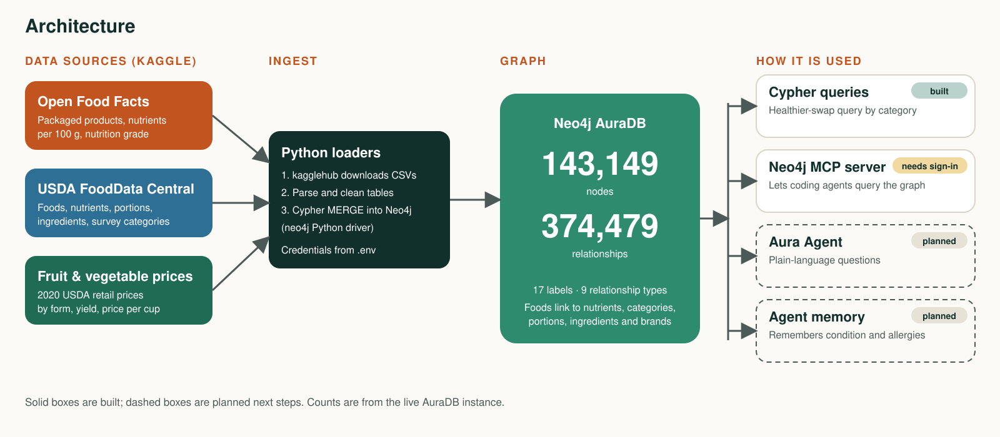
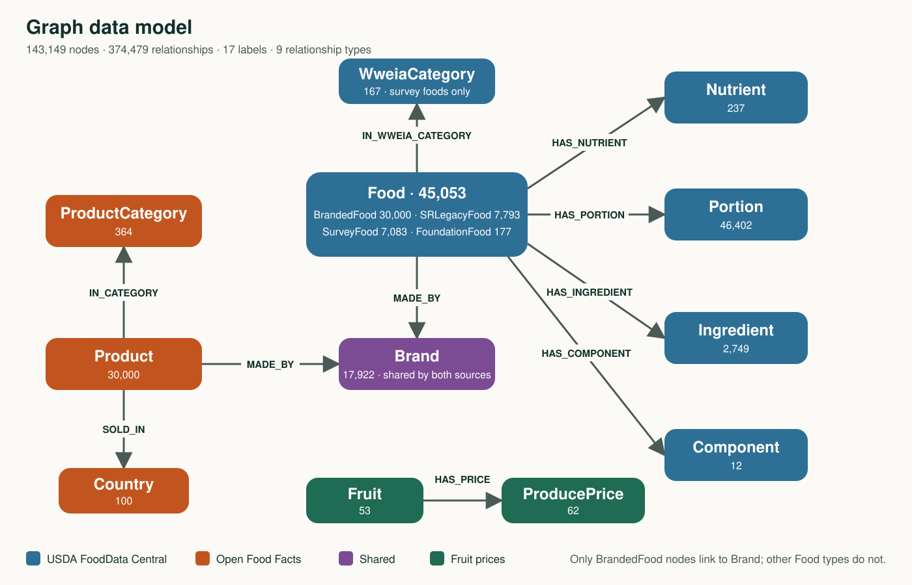

# NutriSwap: a food and nutrition knowledge graph

> *Make it like this, but better for me.*

NutriSwap is a Neo4j graph of foods, nutrients, brands and prices, built for the Neo4j Mini Agentic Hack. It answers connected questions such as *"I want mac and cheese, but with less sodium. What is a similar food that is better, and why?"* by following the relationships between foods, their categories and their nutrients.

The graph runs on **Neo4j AuraDB** and currently holds **143,149 nodes** and **374,479 relationships**.

## Architecture



| Layer | What it does | Status |
|---|---|---|
| Data sources | Three public Kaggle datasets (see below) | Loaded |
| Python loaders | Download with `kagglehub`, clean the tables, load into Neo4j with Cypher using the `neo4j` driver | Built |
| Neo4j AuraDB | Stores the graph; credentials come from `.env` | Running |
| Cypher queries | Healthier-swap query by food category | Built and tested |
| Neo4j MCP server | Lets coding agents such as Claude Code query the graph | Configured, needs sign-in |
| Aura Agent | Plain-language questions over the graph | Planned |
| Agent memory | Remembers a user's condition and allergies between sessions | Planned |

## Data sources

| Source | Kaggle dataset | What it adds to the graph |
|---|---|---|
| Open Food Facts | `openfoodfacts/world-food-facts` | Packaged products with brand, country, category, nutrition grade and nutrients per 100 g |
| USDA FoodData Central | `stoicstatic/fooddata-central-nutrition-and-component-data` | Foods (branded, SR Legacy, Foundation, survey), nutrients, portions, ingredients and survey categories |
| Fruit and vegetable prices | `vstacknocopyright/fruit-and-vegetable-prices` | 2020 USDA retail prices by form, yield and price per edible cup |

## Data model



The model has three connected parts that meet at `Brand`:

- **USDA:** `Food` nodes carry the sub-labels `BrandedFood`, `SRLegacyFood`, `FoundationFood` and `SurveyFood`. Survey foods are prepared dishes grouped into `WweiaCategory` nodes, which is what makes "similar food" a graph relationship.
- **Open Food Facts:** `Product` nodes link to `Brand`, `Country` and, where known, `ProductCategory`.
- **Prices:** `Fruit` nodes link to `ProducePrice` nodes (separate from the food data).

### Node labels

| Label | Count | Notes |
|---|---:|---|
| Portion | 46,402 | Household portions with gram weight |
| Food | 45,053 | Every USDA food. Sub-labels: BrandedFood 30,000, SRLegacyFood 7,793, SurveyFood 7,083, FoundationFood 177 |
| Product | 30,000 | Open Food Facts products |
| Brand | 17,922 | Shared by `Product` and `BrandedFood` |
| Ingredient | 2,749 | |
| ProductCategory | 364 | |
| Nutrient | 237 | Name, unit, USDA nutrient number |
| WweiaCategory | 167 | Survey food categories (for example "Macaroni and cheese") |
| Country | 100 | |
| ProducePrice | 62 | |
| Fruit | 53 | |
| FoodCategory | 28 | No relationships in the graph yet |
| Component | 12 | Foundation food components (for example bone and cartilage) |

### Relationship types

| Relationship | From → to | Count | Properties |
|---|---|---:|---|
| HAS_NUTRIENT | SRLegacyFood → Nutrient | 97,232 | `amount`, `data_points`, `min`, `max`, `median` |
| HAS_NUTRIENT | SurveyFood → Nutrient | 92,079 | same |
| HAS_NUTRIENT | FoundationFood → Nutrient | 1,815 | same |
| MADE_BY | Product → Brand | 35,253 | |
| MADE_BY | BrandedFood → Brand | 30,000 | |
| HAS_PORTION | SurveyFood → Portion | 31,766 | |
| HAS_PORTION | SRLegacyFood → Portion | 14,449 | |
| HAS_PORTION | FoundationFood → Portion | 187 | |
| SOLD_IN | Product → Country | 30,761 | |
| HAS_INGREDIENT | SurveyFood → Ingredient | 24,810 | `amount`, `unit`, `gram_weight`, `seq_num` |
| IN_CATEGORY | Product → ProductCategory | 8,898 | |
| IN_WWEIA_CATEGORY | SurveyFood → WweiaCategory | 7,083 | |
| HAS_COMPONENT | FoundationFood → Component | 84 | `gram_weight`, `pct_weight`, `is_refuse` |
| HAS_PRICE | Fruit → ProducePrice | 62 | |

### Key properties

- **Product** (Open Food Facts): `name`, `code`, `nutrition_grade`, `nutrition_score`, `ingredients_text`, `serving_size`, and nutrients per 100 g: `energy_100g`, `fat_100g`, `saturated_fat_100g`, `carbohydrates_100g`, `sugars_100g`, `fiber_100g`, `proteins_100g`, `salt_100g`, `sodium_100g`.
- **Food** (USDA): `fdc_id`, `description`, `data_type`, `publication_date`, and summary nutrients: `energy_kcal`, `fat_g`, `saturated_fat_g`, `carbohydrates_g`, `sugars_g`, `fiber_g`, `protein_g`, `sodium_mg`, `cholesterol_mg`, `iron_mg`, `calcium_mg`, `potassium_mg`, `vitamin_c_mg`.
- **ProducePrice:** `form`, `year`, `retail_price`, `retail_price_unit`, `yield`, `cup_equivalent_price`, `cup_equivalent_size`, `cup_equivalent_unit`.

## Example: a healthier swap

The question: *"I want mac and cheese, but with less sodium. What is a lower-sodium alternative in the same category?"*

The query finds foods whose description mentions mac and cheese, then lists other foods in the same survey category with less sodium, ranked by how much sodium is saved:

```cypher
MATCH (f:Food)-[:IN_WWEIA_CATEGORY]->(cat:WweiaCategory)
WHERE
  toLower(f.description) CONTAINS 'macaroni and cheese' OR
  toLower(f.description) CONTAINS 'mac & cheese'
MATCH (alt:Food)-[:IN_WWEIA_CATEGORY]->(cat)
WHERE alt.sodium_mg < f.sodium_mg
RETURN
  f.description AS MacAndCheeseOption,
  f.sodium_mg AS OriginalSodium_mg,
  alt.description AS LowerSodiumAlternative,
  alt.sodium_mg AS AlternativeSodium_mg,
  (f.sodium_mg - alt.sodium_mg) AS SodiumSaved_mg,
  cat.description AS Category
ORDER BY SodiumSaved_mg DESC
LIMIT 10
```

Example result: "Macaroni and cheese, baby food, toddler" (264 mg sodium) against "Peas and brown rice, baby food" (6 mg) in the category "Baby food: meat and dinners".

The text match also catches dishes that only contain mac and cheese as a side, such as "Salisbury steak with gravy, macaroni and cheese, frozen meal". The query does not compare calories, so a result can be a very different dish (see the limitations below).

To check the graph size at any time:

```cypher
MATCH (n) RETURN count(n) AS nodes;
MATCH ()-[r]->() RETURN count(r) AS relationships;
```

## Roadmap

1. Add `Condition` nodes with `LIMITS` relationships to nutrients, with a guideline source on each limit.
2. Add allergens and recipe-to-ingredient swaps (`SUBSTITUTE_FOR`).
3. Create an Aura Agent with the swap query as a tool, plus Text2Cypher as a fallback.
4. Add agent memory so a user's condition and allergies are remembered between sessions.

## Setup

1. Create a Neo4j AuraDB instance and copy its connection details.
2. Put them in `.env` (never commit this file):

   ```
   NEO4J_URI=
   NEO4J_USERNAME=
   NEO4J_PASSWORD=
   NEO4J_DATABASE=
   ```

3. Optional: connect Claude Code to the instance through the Neo4j MCP server:

   ```
   claude mcp add --transport http neo4j-mcp https://<instance-id>.mcp-instances.neo4j.io
   ```

   Then run `/mcp` and sign in.

## Built with

Neo4j AuraDB, Cypher, Python with the `neo4j` driver, `kagglehub`, Claude Code, the Neo4j Skills and the Neo4j MCP server.
